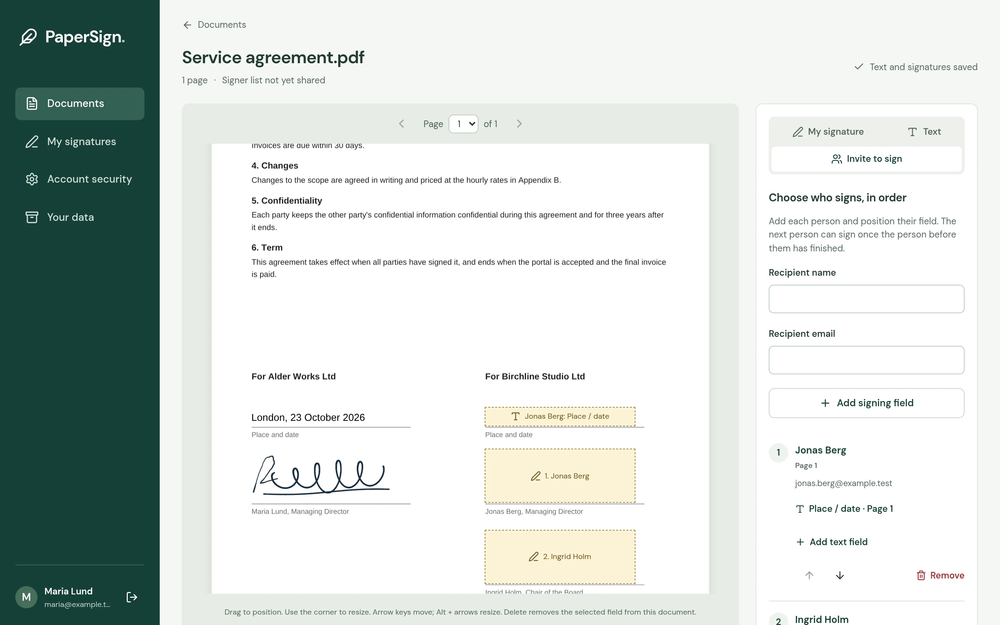
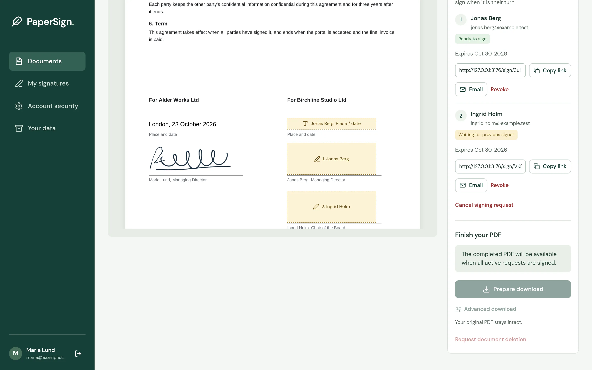
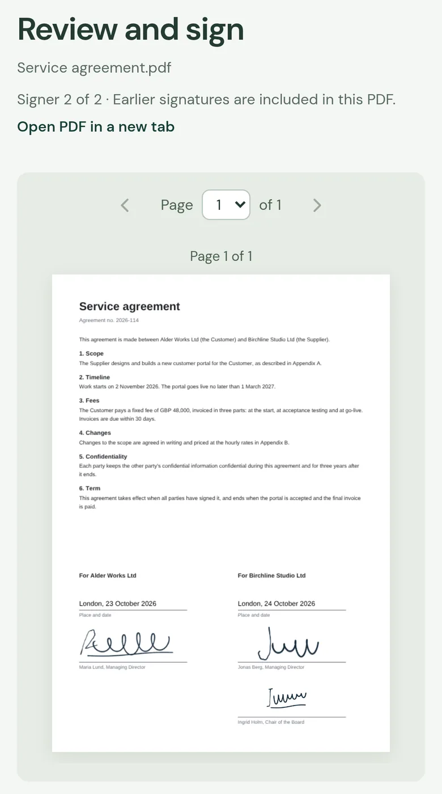
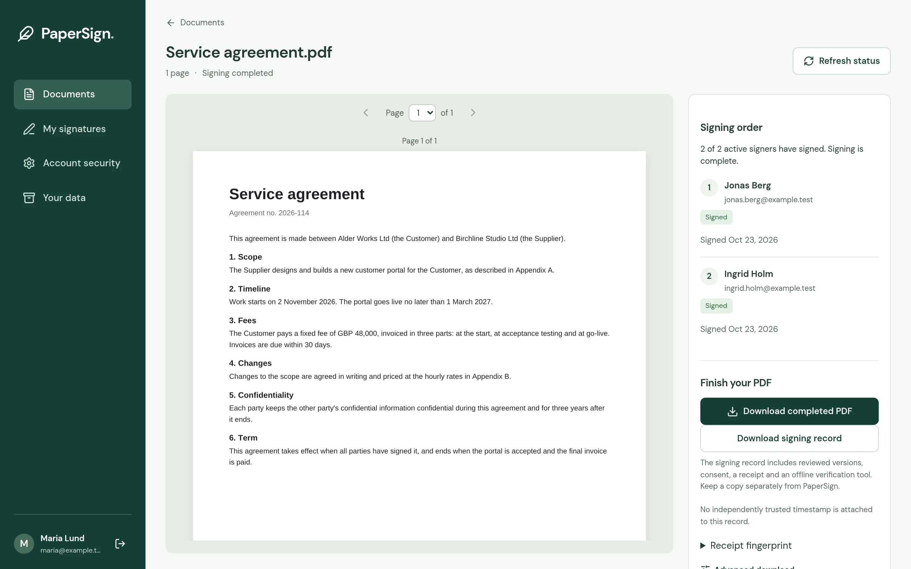

<p align="center">
  <picture>
    <source media="(prefers-color-scheme: dark)" srcset="docs/images/papersign-logo-dark.png">
    
  </picture>
</p>

<h3 align="center">Get documents signed on your own server.</h3>

<p align="center">
  Open-source PDF signing. Sign a PDF yourself, have others sign in the order
  you choose, and keep the signed PDF with a record you can check later.
</p>

<p align="center">
  <a href="https://github.com/io7/papersign/actions/workflows/ci.yml"></a>
  <a href="https://github.com/io7/papersign/releases"></a>
  <a href="https://github.com/io7/papersign/pkgs/container/papersign"></a>
  <a href="LICENSE"></a>
</p>

<p align="center">
  <a href="https://io7.net/papersign/"><strong>Website</strong></a> ·
  <a href="docs/self-hosting.md"><strong>Self-hosting guide</strong></a> ·
  <a href="docs/api-keys.md"><strong>API and AI assistants</strong></a> ·
  Made by <a href="https://io7.net">io7</a>
</p>



## Why PaperSign

- **On your own server.** One Docker image, with PostgreSQL, hourly database
  backups and automatic HTTPS if you want it. Documents, signatures and records
  stay with you.
- **Signers need no account.** They confirm a code sent to their email address,
  see the earlier signatures in place, fill in details such as the place and
  date, and sign with a finger, mouse or pen.
- **A record you can check later.** The final PDF comes with a signing record:
  what each person reviewed, their consent and a receipt, with an offline tool
  that checks it without PaperSign running.
- **Ready for scripts and AI assistants.** Admin API keys, a command-line client
  that places fields next to text in the PDF and previews them, and an MCP
  server for assistants such as Claude.
- **MIT licence.** Use it at work, change it, or build it into your own product.

<table>
  <tr>
    <td width="40%" valign="top"><br><sub>Signers in the order you choose, each with a private link.</sub></td>
    <td width="20%" valign="top"><br><sub>Signing on a phone, no account needed.</sub></td>
    <td width="40%" valign="top"><br><sub>The completed PDF and its signing record.</sub></td>
  </tr>
</table>

PaperSign signatures are drawn or uploaded signatures with a consent record and
a verified email address. They are not BankID or qualified electronic
signatures. All screenshots show made-up data.

## Quick start

```sh
cd docker
cp .env.example .env    # set APP_URL, OPERATOR_NAME, both secrets and SMTP
docker compose up -d
docker compose exec web papersign bootstrap-admin --email you@example.com
```

`docs/self-hosting.md` covers trying it without a mail server, HTTPS, backups,
restore and upgrades.

## All features

- Email/password registration, email verification and password recovery;
  account-owned documents and reusable signatures. Admin access requires an
  authenticator code, with recovery codes and session management.
- PNG upload with automatic white-background removal, and mouse, pen or touch
  drawing with undo, clear and ink color controls. Rename signatures and select
  a default.
- Continuous PDF preview, page navigation, drag/resize and keyboard placement
  controls. Delete removes a selected placement from the page, leaving the saved
  signature in your account.
- Positioned text for names, places, dates and other short details. Recipient
  text fields are completed and frozen together with their signature, and appear
  in later signers' reviews and the final PDF.
- Background PDF export, optionally rasterized at 200 DPI. Page crop boxes,
  dimensions and rotations are preserved. Originals stay unchanged.
  **Advanced download** contains the rasterization option; ordinary downloads
  preserve the PDF text and other original content.
- Optional organization certificate seals, trusted RFC 3161 timestamps and
  embedded validation evidence, implemented in Node with a separate key-holding
  service. See `CERTIFICATE-SEALING.md` for configuration and supported profiles.
- Up to 10 recipients per document in a fixed signing order, mailbox verification,
  versioned consent, seven-day signing links, reissue, revocation and cancellation.
  Each signer reviews the PDF with the earlier signatures included.
- Retained review PDFs, immutable final PDFs, acceptance receipts and a portable
  evidence package with an offline Node verifier. Recipients can retrieve their
  completed record after signing-link expiry using a fresh email challenge.
- Optional standalone RFC 3161 timestamps of the evidence manifest, without an
  organization certificate. Provider configuration is separate from PDF sealing.
- Copyable signing links. Invitation emails have a complete preview and a
  separate send action. SMTP is required for email verification and recovery.
- Admin section with account invitations, Admin/User roles, usage statistics,
  searchable users and uploaded documents, and audited access to original PDFs.
  Account invitations also work when public registration is closed.
- Admin-managed API keys for programs that prepare signing requests, with a
  command-line client that places fields next to text found in the PDF and
  previews the result. See `docs/api-keys.md`.
- Storage quotas, deletion requests and recoverable trash. Permanent deletion
  requires a separate guarded operator action; completed records never expire
  automatically.

Participants use visual signatures with a consent record. The optional final
organization seal does not give participants individual certificate signatures
or establish their identity. Email challenges establish control of the addressed
mailbox, not a person's legal identity or authority to represent a company.
Independent receipts and optional trusted timestamps have different guarantees;
see `docs/signing-evidence.md`.

## Administer accounts

Admins with verified email and an authenticator-confirmed session can open
**Admin** to manage users, invitations, documents and operational status. Set up
the authenticator and save recovery codes in **Account security**.
Create a private account invitation, copy its link, or review its email before
choosing to send it when SMTP is configured. Account invitations expire after
seven days and can be revoked. They create PaperSign accounts; document signing
links remain a separate workflow that does not require an account.

Admins can change roles and open other users' uploaded original PDFs. At least
one Admin must remain, and changes to roles take effect on the next Admin API
request. Ordinary document and signature routes retain their ownership checks.
The Admin section does not provide another user's signature images or editing
access to their documents. See `ADMINISTRATION.md` for the privacy boundary,
statistics definitions and guarded first-Admin setup.

## Invite people to sign

Open a PDF and choose **Invite to sign**. Add each person's name and email, place
their signing field, and use the up/down controls to set the order. Then choose
**Create signing links** and copy each person's private link.

Use **Add text field** beside a signer to request a detail such as **Place / date**.
Position its box, edit its label and font size, and add any other required fields
before creating the links. The signer enters each value and sees it on the PDF
before agreeing to sign. Labels are instructions; only entered values are printed.

To enter text yourself, choose the **Text** tab, enter a value and choose **Add
text to page**. Select the box to edit its value or font size; drag or use arrow
keys to position it. Width and height resize independently. Text, font size and
delete controls appear beside the selected field. Click outside a field to
deselect it; select it again to continue editing. Text and signature edits save
automatically after a short pause, and before navigating away or preparing a
download. The save status shows any failure with a **Retry save** action.
Unshared signer lists are kept only while the editor is open; choose **Create
signing links** to save the signer list.

Text uses a single line of up to 200 characters in Helvetica, with Latin letters
(including æ, ø and å), numbers and punctuation. Choose 6 to 36 pt; text shrinks
uniformly to fit its box, never below 6 pt. Enlarge the box or shorten the value
if it does not fit. Each signer can have up to ten required text fields.

You can share all the links immediately. The intended recipient must verify an
email code before viewing and accepting the document. Only the first unfinished signer can
sign; everyone else sees a waiting screen with **Check again**. Completing one
signature unlocks the next person's link, and with email configured PaperSign
tells that person it is their turn. The owner can refresh the signer list
to see who is ready, waiting, signed, revoked or expired.

Creating links fixes the document and signing order. Each link expires seven days
after creation, including time spent waiting. An expired earlier request blocks
later signers until the owner reissues or revokes it. Reissue replaces the old
link. Revoking a request skips that person;
the finished PDF includes only the people who signed. A changed document revision
requires the recipient to review the updated PDF before signing.

Final acceptance automatically queues one immutable ordinary PDF. The final
receipt fingerprints its portable evidence package; save it independently. The
owner can also explicitly review and finalize a document signed only by them.
Cancelling an unfinished workflow preserves completed acceptances and labels the
result as cancelled. Old in-flight workflows without historical acceptance
evidence retain a hash-checked final PDF with an explicit incomplete-record notice;
PaperSign does not invent earlier consent or issue a complete evidence package.

## Stack

Vue 3, TypeScript, Vite, Fastify, Better Auth, PostgreSQL, Drizzle, PDF.js, pdf-lib,
pg-boss and @napi-rs/canvas. Server-side PDF rasterization uses PDF.js and
@napi-rs/canvas in Node, with pdf-lib assembling the image-only PDF. Dependencies
are pinned in package-lock.json. Node 24 is required; neither the app runtime nor
its tests require Python. Production uses Debian's PostgreSQL 17; the isolated
development database uses PostgreSQL 18.

Sealing uses MIT-licensed LibPDF with permissive dependencies, PKI.js/ASN1.js and
Node crypto. No commercial signing SDK is used. See `THIRD-PARTY-SIGNING.md` for
licence notices. Cryptographic tests use OpenSSL as an independent verifier;
the application runtime does not invoke it.

## Self-host with Docker

One image runs the web application, the PDF worker, migrations and operator
commands. `docker/compose.yaml` adds PostgreSQL, an hourly database backup and,
optionally, Caddy with an automatic HTTPS certificate:

```sh
cd docker
cp .env.example .env    # set APP_URL, OPERATOR_NAME, both secrets and SMTP
docker compose up -d
docker compose exec web papersign bootstrap-admin --email you@example.com
```

Release images are published as `ghcr.io/io7/papersign`. `docs/self-hosting.md`
covers trying it without a mail server, HTTPS, backups and restore, upgrades
and the security defaults. `docker/smoke-test.mjs` checks a fresh installation
end to end.

## Local development

1. Copy `.env.example` to `.env`, generate a unique database password and a random
   `BETTER_AUTH_SECRET` of at least 32 characters. Keep `.env` private.
2. Run `npm ci`.
3. Run `npm run dev:db` in one terminal. This starts a dedicated PostgreSQL instance
   on loopback port 54376 under `.local/postgres`; it never uses a shared database.
4. Run `node --import tsx scripts/dev-mail.ts` in another terminal. Configure
   `.env` for its loopback SMTP listener as shown in `.env.example`. It only
   accepts `example.invalid` and `example.test` recipients and never relays mail.
   Its local inbox API is http://127.0.0.1:3186/messages.
5. Run `npm run db:migrate` and `npm run build`.
6. Run `npm start` and `npm run worker` in separate terminals, then open
   http://127.0.0.1:3176.

For frontend hot reload, set `APP_URL=http://127.0.0.1:5176` and use `npm run dev`,
`npm run dev:web`, and `npm run dev:worker`. Restart the server after rebuilding
production assets so its static route map points to the current hashed files.

## Verification

With the local app, worker and synthetic mailbox running, `npm test` exercises
account and signer verification, recovery, Admin authentication, tenant isolation,
document lifecycle, evidence integrity, PDF export and cryptographic fixtures.
The opt-in evidence database integration case uses
`EVIDENCE_DB_INTEGRATION=1 npx vitest run tests/evidence-integration.test.ts` against
the isolated local database. Cryptographic fixture tests use a local OpenSSL
installation; no live timestamp provider is contacted.

`npm run test:e2e` covers desktop and mobile workflows in Chromium. It uses only
generated test documents and synthetic identities. Email tests deliver only to
the loopback sink; no real recipient is contacted.
It uses Playwright's Chromium (`npx playwright install chromium`); set
`CHROMIUM_PATH` to use another Chromium build. Verification workflows are restricted
to the local service and its synthetic-only mailbox. These test commands do not
authorize production mutations or real delivery. See `docs/signing-evidence.md`
for offline verification and the isolated backup/restore rehearsal.

## Limits and data model

PDFs: 25 MB and 100 pages each; 200 retained documents per account. The default
500 MiB account quota counts unique retained originals, previews, signatures,
exports, evidence and timestamps, including recoverable trash. It is configurable
with `ACCOUNT_STORAGE_LIMIT_BYTES`. Up to three exports per account may be queued
or working by default (`MAX_ACTIVE_EXPORTS`).
Signatures: 20 active entries, PNG uploads under 2 MB. Each document may produce up
to 30 exports; identical revision/format/sealing-policy exports are reused. Drawing, PDF parsing,
rendering and HTTP requests have input/resource/time limits.
The API allows 180 requests a minute per client address, with stricter limits
for sign-in, uploads, exports and email codes. Page files (the app shell,
scripts, styles and icons) are not rate-limited, so a busy office behind one
address never receives a blank page. Pages other than sign-in and Documents,
and the PDF libraries, load when first opened; an open tab that asks for code
from an earlier release reloads that page once.

Files are private on disk. Ordinary account routes check ownership; signing links
and verified mailbox sessions grant only their assigned access. A dedicated Admin route also permits
read-only access to any uploaded original PDF and records that access in the
administration audit. Removing a signature hides it from the library while
retaining existing document/export references. Recipient signatures are separate
immutable PNG copies. Signing locks
the document; completed, wholly revoked or cancelled workflows can be exported.
Expired pending links can be reissued or revoked by the owner.

Export records serve as a durable outbox for pg-boss. A worker reconciles queued
exports after outages. Interrupted work older than fifteen minutes becomes retryable
through an export retry. Retrying a canonical final preserves its frozen inputs
and export identity. PNGs and PDFs stay on the server's filesystem; metadata
and consent history live in PostgreSQL.

An owner's deletion request starts a 30-day
recovery period. Owners can restore recoverable documents; trash continues to
count towards storage. There is no automatic expiry or purge. Permanent document
deletion uses the reviewable plan and fingerprint-guarded operator CLI described
in `docs/signing-evidence.md`; interrupted file cleanup is resumable. Account
deletion requests require manual review. Backup expiry is a separate operator
responsibility and is not performed by the document deletion command.

## Install without Docker

`deploy/` holds a systemd installation for a dedicated Debian 13 host or
container named `papersign`, with PostgreSQL on the same host and a reverse
proxy in front that terminates HTTPS.

`deploy/bootstrap-debian.sh` installs Node with an official checksum check and
PostgreSQL, creates the private service user, and generates
`/etc/papersign/papersign.env` locally. Run it as root with `APP_URL` (the https
address) and `TRUSTED_PROXY` (the reverse proxy's IP address) set. Never copy a
development environment or data into production. `deploy/papersign.nft` admits
the application port only from the reverse proxy and loopback; set the proxy's
address in it before loading it.

`deploy/install-release.sh RELEASE_ID ARCHIVE` installs a prebuilt archive with
`package.json`, `package-lock.json`, `dist/`, `dist-server/`, `drizzle/`
and `deploy/`. It installs production dependencies, migrates the app's own
database, atomically switches `/opt/papersign/current`, restarts the two services,
and checks health. Keep older release directories for rollback. Database rollback
requires a compatible schema or a tested restore; do not blindly reverse migrations.
First-Admin setup is a separate guarded operator command in `ADMINISTRATION.md`.
Keep a fresh pre-upgrade backup and preserve subsequent user changes before any
rollback.

Services: `papersign-web`, `papersign-worker`, `papersign-backup.timer` and
`papersign-monitor.timer`, which checks service health, worker heartbeat, queue
failures, storage and backup freshness. Set `ALERT_WEBHOOK_URL` and verify alert
delivery before relying on notifications; without it, monitoring writes to the
journal only.
Configuration: `/etc/papersign/papersign.env` (root:papersign, 0640).
Private files: `/var/lib/papersign/data`.
Hourly database dump: `/var/lib/postgresql/papersign.dump`.
Systemd confines writes to app data and private temporary directories and limits
each application service to 1536 MB. Inspect failures with `journalctl -u
papersign-web -u papersign-worker`; health is `/api/health`.

A restore must keep the database, file directory and `BETTER_AUTH_SECRET`
together; that secret also encrypts invitation tokens. The hourly logical dump
is an additional recovery option, not a replacement for a backup of the host.

## Operating PaperSign

Set `OPERATOR_NAME` to the organization that runs the installation; the privacy
page names it as the service operator. Set `REGISTRATION_ENABLED=false` to close
public registration; valid account invitations can still be accepted.

Verification, password recovery and recipient signing need working mail
delivery and fail closed without it. Confirm the provider, sender/domain
configuration and actual delivery before production use. Manually initiated
invitation emails show recipients, subject and body before sending;
user-requested verification and recovery messages are sent by their respective
actions, and the "your turn" notice goes to the next signer when an earlier
request is signed or revoked. Tests must use the synthetic local sink, never real recipients.

Signing and invitation links carry private tokens in the URL. Turn off access
logging for PaperSign in the reverse proxy, and set `TRUSTED_PROXY` to that
proxy's address only, so visitors cannot supply their own forwarded address.
The application receives a server-derived client IP for sign-in rate limits.

Optional timestamps need an authorized provider and independently selected
trust and revocation configuration. Organization sealing is a separate optional
configuration; see `CERTIFICATE-SEALING.md`.

## License

MIT; see `LICENSE`. Third-party notices for the signing dependencies are in
`THIRD-PARTY-SIGNING.md` and `licenses/`.
